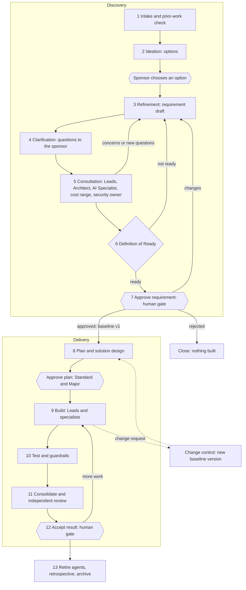

# Delivery lifecycle

How an assignment moves from a request to an accepted result, set against a typical software
delivery lifecycle (ADR-0028). GitHub renders the diagram on this page.

## Stage by stage

| Typical stage | Here | Owner | Output | Gate |
| --- | --- | --- | --- | --- |
| Request | Intake | Code, Knowledge Steward | Request stored verbatim; prior-work matches | None |
| Ideation | Options | Product Manager | `OptionsDraft` | Sponsor chooses |
| Refinement | Requirement draft | Product Manager | `RequirementDraft` | None |
| Clarification | Questions and answers | Product Manager | `ClarifyingQuestions`, answers | Mandatory questions block |
| Consultation | Feasibility and concerns | Leads, Solution Architect, AI Specialist, Delivery Controller, named people | `ConsultationNote` each | Unresolved concerns shown to sponsor |
| Requirement sign-off | Approve requirement | Sponsor | Baseline, versioned | **Human** |
| Planning | Workstreams | Head of Delivery | `PlanDraft` | With design |
| Design | Solution design | Solution Architect | `SolutionDesignDraft` | **Human**: approve plan (Standard, Major) |
| Build | Tasks and specialists | Leads, Recruiter | Results with evidence | Evidence gate (code) |
| Test | Checks written first, then run | Tester | Test reports | Binding on the Lead |
| Review | Independent challenge | Reviewer | `ReviewFindings` | Material findings returned |
| Acceptance | Check against the baseline | Product Manager, then sponsor | `AcceptanceCheck` | **Human** |
| Release | Pull requests | Action executor | Pull request | People merge (ADR-0021) |
| Operate | Not in the platform | Your existing pipeline and teams | | |
| Learn | Retrospective | Knowledge Steward | Lessons, proposed changes | Pull request |

## By size tier

| Stage | Small | Standard | Major |
| --- | --- | --- | --- |
| Ideation | One reading plus alternatives set aside; full options only if ambiguous | Two or three options | Two or three options |
| Consultation | One Lead; cost range | Leads, Solution Architect, AI Specialist if relevant, cost range | Adds the human security owner |
| Human gates | Approve requirement; accept result | Approve requirement; approve plan; accept result | Same as Standard |

## Definition of Ready

Checked by code before the approval gate is raised. A draft that fails goes back to refinement.

- An option was chosen by the sponsor, or the single reading was shown.
- Outcome, users and the decision the result must support are stated.
- At least one mandatory success criterion; each has a measure and a threshold.
- Scope and non-goals are stated.
- No mandatory question is open.
- Every consultation note is in, and every concern is answered in the draft or marked unresolved for the sponsor.
- Assumptions are listed as assumptions.
- Data classification, size tier and budget ceiling are set.
- A sponsor is named; a security owner is named where required.

## Change control

| Situation | What happens |
| --- | --- |
| Sponsor wants to change the requirement before approval | Back to refinement; no change record needed |
| Change after approval | Change request. The Product Manager states the effect on criteria, cost and time using the Delivery Controller's figures. Sponsor approves or drops it |
| Approved change | New baseline version. Work that depends on changed criteria stops and is re-planned; the rest continues |
| A Lead or the Architect finds the requirement cannot be met | Raised to the Product Manager as a change request; never resolved silently |
| Result accepted against which version | The latest approved baseline; the deliverable records the version |

## Limits

| Limit | Default |
| --- | --- |
| Refinement rounds | 3, then the run ends as not confirmed |
| Options offered | 3 |
| Questions per round | 5 |
| Discovery budget | A ceiling per tier, set with the other ceilings (action H-08) |
| No answer at a gate | The run expires; nothing is built |
