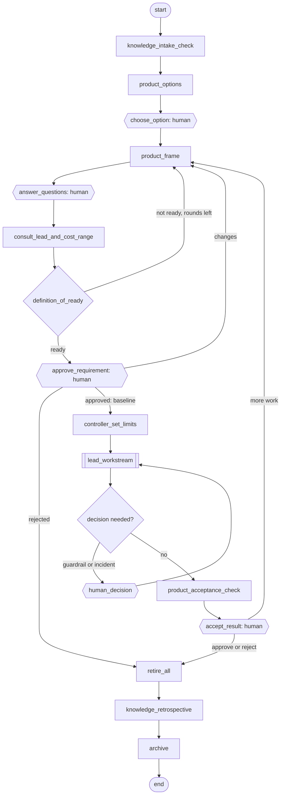
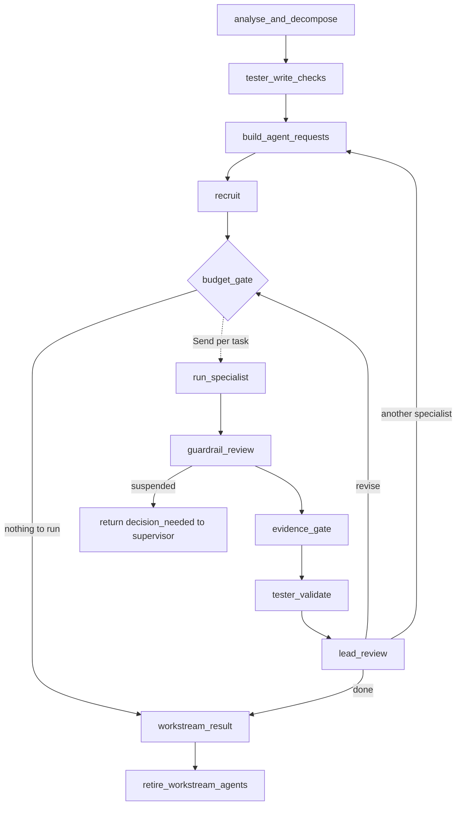

# Runtime design

## Supervisor graph (Small tier, first release)

The nodes before `approve_requirement` are the discovery stage (ADR-0028); see
[delivery-lifecycle.md](delivery-lifecycle.md). `choose_option` and `answer_questions` are
skipped when there is one reading and no question. In Standard and Major, consultation fans out
to the Leads named in the draft, the Solution Architect and, where relevant, the AI Specialist.

After the baseline, Standard and Major tiers add, in this order (ADR-0026):

1. `delivery_plan`: the Head of Delivery drafts workstreams and marks whether there is an AI component.
2. `ai_advice`: the AI Specialist, only if the AI component is marked.
3. `solution_design`: the Solution Architect drafts the design across the workstreams.
4. The plan approval gate. The sponsor approves the plan and the design together.
5. Fan-out to the Leads. Each receives the approved design unchanged. A Lead may ask for AI advice, within a limit.
6. Staged consolidation, then `design_conformance` by the Solution Architect.
7. The Reviewer, and for Major the CTO Agent recommendation.

A disagreement between a Lead and the design goes to the CTO Agent for arbitration.

## Lead subgraph

The draft in `reference/lg/lead.py` differs in two ways that work packages correct: it pauses for
the guardrail gate inside the subgraph, and the Tester does not yet write checks first.

## State

| Scope | Lives in | Holds |
| --- | --- | --- |
| Project | Supervisor state | Ids of requirement, plan and results; approvals; loop counters; tier; outcome |
| Workstream | Lead subgraph state | Task ids, specification ids, outcome ids, review decisions, revision counters |
| Task | The `Send` payload | One task, one specification, reservation id, revision comments |
| Agent | Inside the worker's agent loop | Messages and notes; discarded when the node returns |

Rules: values are JSON-serialisable and re-validated with Pydantic at node boundaries. Keys
written by parallel branches have reducers. A subgraph returns only reducer keys to its parent.
State holds references; bodies are read from the stores.

## Loops and their ceilings

| Loop | Default ceiling | At the ceiling |
| --- | --- | --- |
| Revisions per task | 2 | Result rejected; task re-staffed if rounds remain, otherwise reported as a gap |
| Recruitment rounds per workstream | 2 | Gap reported |
| Refinement rounds in discovery | 3 | Run ends as not confirmed |
| Sponsor rework cycles | 2 | Run ends with the last deliverable |
| Questions per task (WP-14) | 2 | Further questions refused; the agent proceeds on a stated assumption or reports a gap |

Counters live in state. A `recursion_limit` is a final backstop.

## Specialist lifecycle

Requested, Validated, Approved, Provisioned, Registered, Assigned, Running, Awaiting review,
Revision requested, Suspended, then Accepted, Failed, Cancelled, Timed out or Rejected, then
Retired. The table of allowed moves is `ALLOWED_TRANSITIONS` in `reference/contracts.py`; the
registry refuses anything else. Retirement revokes access first and cannot be recorded while
access is live.

## Human gates

Every gate is an interrupt raised by the supervisor. Subgraphs return `decision_needed`; they do
not pause themselves (ADR-0016).

| Gate | Approver | No answer means |
| --- | --- | --- |
| Choose an option; answer mandatory questions | Sponsor | Run expires |
| Approve requirement (every tier) | Sponsor | Run expires; nothing built |
| Approve plan and design (Standard, Major) | Sponsor | Run expires; nothing built |
| Change request after the baseline | Sponsor | Change not made; work continues on the current baseline |
| Budget or deadline overrun | Sponsor | New work stops; partial result assembled |
| Proposed change other than a pull request | Change owner | Change not made |
| Guardrail suspension | Security owner | Agent terminated |
| Incident: runbook exhausted | Sponsor | Task cancelled |
| Accept result | Sponsor | Result stays pending; agents are retired regardless |

Questions from agents are not gates. They go to a question store outside graph state; a waiting
task is parked with its dependants while other work continues, and scheduling nodes pick up
answers at safe points (ADR-0031, built in WP-14).

Pull requests have no gate in the graph: the executor opens them and people review and merge in GitHub (ADR-0021).

A node that calls `interrupt()` re-runs from its first line on resume. Gate nodes therefore do
nothing before the call, and any model work sits in the node before.

## Failure handling

| Situation | Response |
| --- | --- |
| Model or tool call fails | Self-healing runbook for that fault; then an incident to a human (ADR-0015) |
| Specialist fails or times out | Outcome recorded as failed; Lead re-staffs within its round limit |
| Result cites unknown evidence | Rejected by schema; agent failed; guardrail event recorded |
| Evidence insufficient | One revision naming the gap; then accepted as partial with confidence capped |
| Budget reservation refused | Task blocked and reported; escalation to the sponsor |
| Two Leads request the same work | Second request held; Head of Delivery assigns one owner |
| Workstream results conflict | Returned to the owning Leads; unresolved conflicts shown to the sponsor with both positions |
| Process dies mid-run | Resumes from the last checkpoint; completed branches are not re-run |
