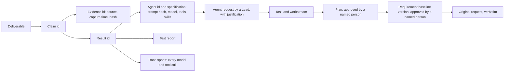

# Traceability and decision tracking

How one request is followed from the sponsor's words to the result, and how every decision is
recorded.

## Three records, one set of identifiers

| Record | Holds | Authoritative for | Kept |
| --- | --- | --- | --- |
| Audit store (PostgreSQL, append-only, hash-chained) | Who asked and approved; every agent request, specification, tool call, permission decision, budget event, suspension, retirement | **Everything that must be proved later** | Retention period (H-09) |
| LangGraph checkpoints (PostgreSQL) | The workflow's state at each step | Resuming and replaying a run | Short; pruned |
| Traces (Application Insights) | Timing, inputs and outputs of model and tool calls, by classification | Diagnosis and evaluation | Per workspace retention |

The audit store never depends on the other two (ADR-0014). A trace that is missing or redacted
does not weaken the audit record.

## What the audit record proves, and what it does not

- **Proves:** nothing stored has been changed, removed or reordered since it was written, when the chain verifies against the anchor kept in immutable storage outside the database.
- **Does not prove:** that every event is true. A compromised governance service could add a false event. Controls against that are access to the writing role, separate owner credentials, and the security review; see ADR-0034.
- **Until WP-12:** there is no external anchor and no separate owner credential, so the first statement holds only against the application role.

## Identifiers carried everywhere

Each appears on every audit event, in checkpoint configuration or state, and as trace metadata.

| Identifier | Meaning |
| --- | --- |
| `project_id` | One assignment. Also the LangGraph thread id |
| `baseline_version` | Which approved requirement the work was done against (ADR-0028) |
| `workstream_id`, `task_id` | Where in the plan |
| `agent_id`, `agent_role` | Which agent, permanent or temporary |
| `specification_id`, `prompt_sha256` | Exactly what the agent was told; includes role skills and skill packs |
| `model_deployment` | Which model answered |
| `graph_version`, `policy_version` | Which code and which rules were in force |
| `data_classification` | Governs redaction and retrieval |
| `correlation_id` | Ties an audit event to its trace span |
| `checkpoint_id` | Ties a decision to the state it was made on |

## Following one claim back

Every arrow is a stored identifier, not an inference.

## The decision register

One row per decision, human or code. Part of the audit store.

| Field | Content |
| --- | --- |
| Decision id, time | |
| Type | Answer to an agent's question, override, choose option, approve requirement, approve plan, change request, budget overrun, resume or terminate a suspended agent, incident, accept result |
| Decided by | A person's Entra identity and role, or the name of the rule for a code decision |
| The card shown | Question, options, recommendation and who recommended it, evidence ids, default, deadline |
| Outcome and comment | |
| What it was based on | `checkpoint_id`, `baseline_version`, and the hash of the card |
| What followed | The next audit event ids |

Rules:

- A human decision is written by the interaction API only after it has verified identity and role.
- An agent's recommendation is recorded as a recommendation, with the agent's id. It is never recorded as a decision (ADR-0008).
- A timeout is recorded as a timeout with the default taken. It is never recorded as approval.
- An agent's answer to another agent's question is recorded as an agent's answer. A person's override of it is a separate row that names what it overrode and gives the reason (ADR-0032).
- Results that relied on an unanswered assumption are marked provisional, and the deliverable lists them.
- Code decisions that change an outcome are recorded too: evidence gate rejections, budget refusals, guardrail suspensions, tier assignment, who was consulted.

## Questions an auditor can answer

| Question | From |
| --- | --- |
| Who approved this requirement, and what exactly did they see? | Decision register |
| Which model and prompt produced this claim? | Result, specification, prompt hash |
| What source supports it, and has the source changed since? | Evidence store; the Tester's re-fetch |
| Was any agent stopped, and who let it continue? | Guardrail events; decision register |
| What did this assignment cost, and who approved an overrun? | Ledger; decision register |
| Was the workflow or a prompt changed between two runs? | `graph_version`, `prompt_sha256`; pull request history |
| Did any content go to a model above its permitted classification? | Gateway permission decisions |
| Can the record have been altered? | Hash chain verification; database permissions |

## What is not yet settled

- Whether prompts and outputs are stored in traces at all for Confidential work, or only their hashes. A decision for information security (H-19).
- Retention periods and deletion on request (H-09, and Legal).
- How long checkpoints are kept before pruning.
