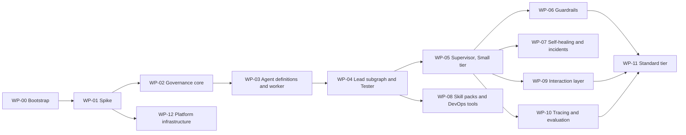

# Roadmap

Build the Small tier end to end on a reduced platform first, prove it, then widen. Each phase
ends at a gate that can stop the work cheaply.

Effort figures are the architect's rough estimates for a team of four to six. They are not based
on this team's velocity. Re-estimate after phase 1.

| Phase | Work packages | Indicative effort | Gate question |
| --- | --- | --- | --- |
| 0. Foundations | WP-00 | Days | Can an implementer build, test and open a pull request? |
| 1. Architecture spike | WP-01 | 2 to 3 weeks | Do LangGraph, LangChain and Foundry behave as the design assumes? |
| 2. Small tier, proven | WP-02 to WP-07 | 6 to 8 weeks | Does one single-domain assignment run end to end with evidenced, tested output and every agent retired? |
| 3. Specialisation and people | WP-08 to WP-10 | 6 to 8 weeks | Can a DevOps assignment produce a checked pull request, with humans deciding through one front door, and quality measured? |
| 4. Standard tier and platform | WP-11 to WP-12 | 8 to 10 weeks | Do multi-domain assignments work on production-shaped infrastructure? |
| 5. Hardening and rollout | To be planned after phase 3 | Not estimated | Will security, risk and operations sign it off? |

Added later, not in the phases above: WP-14 (questions without stopping the run, and human override), suggested straight after WP-09; and WP-13 (reasoning patterns), last. Neither is estimated.

## Rules for the plan

- **The spike comes first.** No work package after WP-01 starts until its findings are recorded
  and the architect has amended any ADR they contradict.
- **One tier at a time.** Standard-tier work does not start until the Small tier passes its gate.
- **Open decisions block only what they touch.** See [open decisions](../requirements/open-decisions.md).
- **Every phase ends with a measured result** written into `docs/plan/` and reviewed by the owner.

## Exit criteria for phase 2

- A single-domain assignment completes without manual intervention in the graph.
- Every material claim cites evidence; a result citing an unknown evidence id is rejected.
- A failed test forces a revision; a result without a passing report cannot be accepted.
- Killing the orchestrator mid-run and restarting resumes from the last checkpoint.
- At the end, no credential is live and every specialist has a retirement record.
- Cost per assignment and model calls per role are reported from the ledger.
